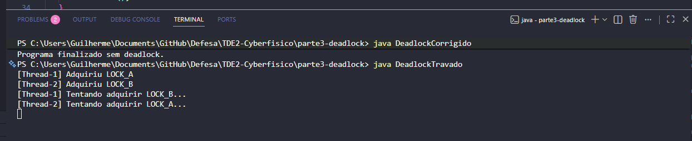

# Trabalho Prático de Programação Concorrente

**Vídeo de apresentação:** [PREENCHER — link do YouTube](https://www.youtube.com/)

Repositório com as três partes práticas do trabalho da disciplina de Sistemas Ciberfísicos / Programação Concorrente.

## Grupo

**Nome do grupo:** PREENCHER

| Integrante | GitHub |
|---|---|
| Eric Juan PREENCHER SOBRENOME | [EricJuanDM](https://github.com/EricJuanDM) |
| Guilherme Zamboni de Albuquerque | PREENCHER |
| Luigi Bilyk de Oliveira | [Luigi2505](https://github.com/Luigi2505) |

**Linguagem:** Java (JDK 17+), usando apenas a API padrão (`Thread`, `synchronized` e `java.util.concurrent.Semaphore`).

## Estrutura

| Pasta | Conteúdo |
|---|---|
| [`parte1-filosofos/`](parte1-filosofos) | Jantar dos Filósofos: versão ingênua com deadlock e versão corrigida por hierarquia de recursos. |
| [`parte2-semaforo/`](parte2-semaforo) | Contador concorrente: condição de corrida e correção com semáforo binário. |
| [`parte3-deadlock/`](parte3-deadlock) | Deadlock com dois locks e correção por ordem global de aquisição. |

Cada parte é compilada e executada dentro da sua própria pasta, como descrito nas seções abaixo.

---

# Parte 1 — Jantar dos Filósofos

Implementação do clássico problema do **Jantar dos Filósofos** proposto por Edsger Dijkstra, demonstrando na prática o surgimento de **deadlock** no protocolo ingênuo e sua prevenção por meio da **hierarquia de recursos**.

## Arquivos da Parte 1

| Arquivo | Descrição |
|---|---|
| `Garfo.java` | Modela o garfo como um recurso com exclusão mútua usando `Semaphore(1, true)` (semáforo binário justo/FIFO para evitar inanição). |
| `FilosofoIngenuo.java` | Thread que adquire sempre primeiro o garfo esquerdo e depois o direito (protocolo ingênuo que leva ao deadlock). |
| `MainIngenuo.java` | Inicializa a simulação da versão ingênua, evidenciando o travamento do sistema. |
| `Filosofo.java` | Thread corrigida com protocolo de hierarquia de recursos (sempre adquire primeiro o garfo de menor ID). Conta o número de refeições. |
| `Main.java` | Inicializa a simulação da versão corrigida com progresso contínuo e sem deadlock. |

## Como executar a Parte 1

Dentro do diretório `parte1-filosofos/`:

```bash
# Compilar todas as classes
javac *.java

# 1. Executar a versão ingênua (trava em deadlock; encerre com Ctrl + C)
java MainIngenuo

# 2. Executar a versão corrigida (execução contínua sem travamentos; encerre com Ctrl + C)
java Main
```

## Dinâmica do problema e por que o impasse surge

Cinco filósofos sentam-se ao redor de uma mesa redonda. No centro há comida e, entre cada par de filósofos vizinhos, há exatamente um garfo compartilhado (total de 5 garfos). Cada filósofo alterna continuamente entre três estados:
1. **Pensando** (não precisa de nenhum garfo);
2. **Com fome** (tenta obter os dois garfos adjacentes);
3. **Comendo** (está de posse dos dois garfos adjacentes).

No protocolo ingênuo (`FilosofoIngenuo`), todo filósofo pega primeiro o garfo à sua esquerda e, em seguida, tenta pegar o da direita. Quando todos os filósofos sentem fome simultaneamente e pegam seu garfo esquerdo, todos os 5 garfos ficam ocupados. Ao tentarem pegar o garfo da direita, todos encontram o recurso retido pelo vizinho. Ninguém avança, ninguém come e ninguém libera o garfo que possui, caracterizando um **deadlock**.

Para tornar o impasse fácil de observar, `FilosofoIngenuo` espera 200 ms depois de pegar o garfo esquerdo, dando tempo para os vizinhos pegarem os seus. Mesmo assim, o deadlock depende do escalonamento das threads: ele **pode** acontecer, mas não é garantido. Se a execução não travar, basta encerrar com `Ctrl + C` e rodar `java MainIngenuo` de novo.

### Log do console da versão ingênua

Saída real de `java MainIngenuo`:

```text
Versao ingenua com deadlock
Filosofo 3 esta pensando.
Filosofo 1 esta pensando.
Filosofo 0 esta pensando.
Filosofo 4 esta pensando.
Filosofo 2 esta pensando.
Filosofo 0 esta com fome.
Filosofo 4 esta com fome.
Filosofo 2 esta com fome.
Filosofo 1 esta com fome.
Filosofo 1 pegou o garfo esquerdo (1).
Filosofo 2 pegou o garfo esquerdo (2).
Filosofo 0 pegou o garfo esquerdo (0).
Filosofo 4 pegou o garfo esquerdo (4).
Filosofo 3 esta com fome.
Filosofo 3 pegou o garfo esquerdo (3).
Filosofo 1 tentando pegar o garfo direito (2)...
Filosofo 0 tentando pegar o garfo direito (1)...
Filosofo 2 tentando pegar o garfo direito (3)...
Filosofo 4 tentando pegar o garfo direito (0)...
Filosofo 3 tentando pegar o garfo direito (4)...
```

Depois da última linha nada mais é impresso e o programa não termina: os 5 garfos estão ocupados e cada filósofo espera o garfo do vizinho. Nenhuma mensagem "pegou o garfo direito" aparece.

## Condições de Coffman no problema dos filósofos

| Condição | Onde aparece no protocolo ingênuo | Estado na versão corrigida |
|---|---|---|
| **Exclusão mútua** | Cada garfo só pode ser usado por um filósofo por vez (`Semaphore(1)`). | **Mantida** (garfos são recursos exclusivos). |
| **Manter e esperar** (*hold and wait*) | O filósofo segura o primeiro garfo enquanto aguarda o segundo. | **Mantida** (continua pegando um por vez). |
| **Não preempção** | Um filósofo não pode retirar à força o garfo da mão do vizinho. | **Mantida** (o garfo só é liberado voluntariamente). |
| **Espera circular** | Filósofo 0 espera o garfo do 1, que espera o do 2, que espera o do 3, que espera o do 4, que espera o do 0: `0 → 1 → 2 → 3 → 4 → 0`. | **ELIMINADA / QUEBRADA**. |

### Como a hierarquia de recursos elimina a espera circular

A solução corrigida (`Filosofo.java`) atribui uma ordem total aos garfos através de seus IDs numéricos ($0, 1, 2, 3, 4$). Em vez de pegar sempre o garfo esquerdo primeiro, todo filósofo adquire obrigatoriamente primeiro o garfo com o menor ID e depois o com maior ID:

$$\text{primeiroGarfo} = \min(\text{garfoEsquerdo}, \text{garfoDireito})$$
$$\text{segundoGarfo} = \max(\text{garfoEsquerdo}, \text{garfoDireito})$$

Os filósofos 0, 1, 2 e 3 pegam na ordem (esquerda, direita), pois seu garfo esquerdo tem índice menor. Já o **Filósofo 4** (entre os garfos 4 e 0) inverte a ordem: pega primeiro o **garfo 0** e depois o **garfo 4**. Com isso, o Filósofo 4 e o Filósofo 0 disputam o mesmo garfo 0 logo no início. Apenas um deles adquire o garfo 0 e o outro fica bloqueado sem segurar nenhum recurso, tornando impossível fechar um ciclo de espera.

## Garantia de progresso e ausência de inanição (Fairness)

1. **Semáforos justos (`new Semaphore(1, true)`)**: O construtor com `fairness = true` garante fila estritamente FIFO (First-In, First-Out) no atendimento das threads que aguardam por cada garfo. Nenhuma thread pode ser preterida indefinidamente pela chegada de novos pedidos.
2. **Contador de refeições**: A cada ciclo de alimentação, o filósofo exibe no log `(Refeicao N)`, por exemplo `Filosofo 0 ta comendo (Refeicao 1)`. Com isso dá para conferir que todos os 5 filósofos comem de forma balanceada.

### Execução da versão corrigida

Início da saída real de `java Main`:

```text
Versao Corrigida Hierarquia de Recursos
Filosofo 0 ta pensando
Filosofo 3 ta pensando
Filosofo 2 ta pensando
Filosofo 4 ta pensando
Filosofo 1 ta pensando
Filosofo 0 ta com fome
Filosofo 0 pegou o garfo 0.
Filosofo 0 pegou o garfo 1.
Filosofo 0 ta comendo (Refeicao 1)
Filosofo 1 ta com fome
Filosofo 3 ta com fome
Filosofo 3 pegou o garfo 3.
Filosofo 3 pegou o garfo 4.
Filosofo 3 ta comendo (Refeicao 1)
Filosofo 4 ta com fome
Filosofo 2 ta com fome
Filosofo 2 pegou o garfo 2.
Filosofo 0 soltou os garfos 0 e 1.
Filosofo 0 ta pensando
Filosofo 1 pegou o garfo 1.
Filosofo 4 pegou o garfo 0.
...
```

Note que o Filósofo 4 pega primeiro o **garfo 0** (o de menor índice), como manda a hierarquia.

Deixando o programa rodar por 30 segundos, o número de refeições de cada filósofo (última `(Refeicao N)` impressa por cada um) foi:

| Filósofo | Refeições em 30 s |
|---|---|
| 0 | 12 |
| 1 | 11 |
| 2 | 12 |
| 3 | 12 |
| 4 | 11 |

O sistema não travou e a diferença entre o filósofo que mais comeu e o que menos comeu foi de apenas 1 refeição, o que mostra progresso contínuo e ausência de inanição.

## Pseudocódigo da hierarquia de recursos

```text
Para cada filosofo p (0 ate 4):
    garfo_esq <- p
    garfo_dir <- (p + 1) mod 5
    primeiro  <- min(garfo_esq, garfo_dir)
    segundo   <- max(garfo_esq, garfo_dir)

Repita:
    pensar()
    estado <- "com fome"
    adquirir(primeiro)
    adquirir(segundo)
    estado <- "comendo"
    comer()
    liberar(segundo)
    liberar(primeiro)
    estado <- "pensando"
```

---

# Parte 2 — Threads e Semáforos: Contador Concorrente

Demonstração de uma condição de corrida em um contador compartilhado e sua correção com um semáforo binário (`java.util.concurrent.Semaphore`).

## Arquivos

| Arquivo | Descrição |
|---|---|
| `ContadorSemSincronizacao.java` | Versão 1: T threads incrementam `count` sem nenhuma sincronização. |
| `ContadorComSemaforo.java` | Versão 2: cada incremento é protegido por `Semaphore(1, true)` (binário e justo/FIFO). |
| `Tabela.java` | Formata a tabela de resultados impressa no terminal. |

Parâmetros usados: **T = 8 threads** e **M = 200.000 incrementos por thread**, valor esperado **T × M = 1.600.000**. Cada programa faz **3 execuções** seguidas e imprime a tabela com os resultados.

## Como executar

Requer JDK 17+. Dentro da pasta `parte2-semaforo`:

```bash
javac *.java
java ContadorSemSincronizacao
java ContadorComSemaforo
```

A versão com semáforo leva de alguns segundos a mais de meio minuto por execução (veja a discussão sobre throughput).

## Resultados

Ambiente: Windows 11, Java HotSpot 17.0.9.

### Versão 1 — sem sincronização

| Execução | Valor Esperado | Valor Obtido | Perdidos | Tempo Gasto |
|---|---|---|---|---|
| 1 | 1.600.000 | 618.821 | 981.179 | 92,21 ms |
| 2 | 1.600.000 | 556.595 | 1.043.405 | 76,72 ms |
| 3 | 1.600.000 | 578.789 | 1.021.211 | 73,17 ms |

### Versão 2 — com semáforo binário (justo)

| Execução | Valor Esperado | Valor Obtido | Perdidos | Tempo Gasto |
|---|---|---|---|---|
| 1 | 1.600.000 | 1.600.000 | 0 | 36.667,59 ms |
| 2 | 1.600.000 | 1.600.000 | 0 | 30.608,02 ms |
| 3 | 1.600.000 | 1.600.000 | 0 | 9.912,73 ms |

A versão sem sincronização perdeu entre 61% e 65% dos incrementos, com um resultado diferente a cada execução. A versão com semáforo chegou ao valor exato nas três execuções, mas levou de 9,9 s a 36,7 s, contra 73 a 92 ms da versão sem sincronização.

> **Sobre o `volatile` na versão 1:** o programa roda as 3 execuções na mesma JVM. Com um `int` comum, a partir da segunda execução o compilador JIT já otimizou `tarefa()`: como nada obriga o valor a ser visível para outras threads, ele pode ler `count` uma vez, somar 200.000 em registrador e gravar uma única vez. A janela de corrida quase some e o resultado sai 1.600.000, escondendo o problema. Com `volatile`, cada `count++` é obrigado a ler e gravar na memória, então o laço não pode ser otimizado assim. O `volatile` **não** torna `count++` atômico (continua sendo ler, somar e gravar), por isso a perda de incrementos continua aparecendo. Ou seja, a versão 1 continua sem exclusão mútua; o `volatile` só impede que a otimização esconda a corrida.

## Discussão técnica

### 1. Por que a versão sem sincronização perde incrementos

A operação `count++` parece única, mas não é atômica. Ela é executada em três passos:

1. **ler** o valor atual de `count` da memória;
2. **somar 1** no registrador;
3. **gravar** o resultado de volta na memória.

Como as 8 threads rodam ao mesmo tempo em núcleos diferentes, duas delas podem ler o mesmo valor (por exemplo, 100) antes que qualquer uma grave. As duas calculam 101 e gravam 101: foram feitos dois incrementos, mas o contador só avançou uma vez. Esse é o *lost update*, típico de uma condição de corrida. O resultado depende de como o escalonador intercala as threads, por isso muda a cada execução.

Por isso o `volatile` não resolve o problema: ele garante que cada leitura e escrita vá à memória, mas não impede que outra thread leia o valor entre o passo 1 e o passo 3.

### 2. Por que a versão com semáforo é correta

O semáforo é criado com **uma única permissão**, então funciona como exclusão mútua (mutex). Uma thread só executa `count++` depois de obter a permissão com `acquire()`, e as outras ficam bloqueadas até ela chamar `release()`. Assim, os três passos (ler, somar, gravar) são executados por uma thread de cada vez, sem intercalação, e nenhum incremento se perde.

O `release()` fica em um bloco `finally` para que a permissão seja sempre devolvida, mesmo se ocorrer uma exceção. Caso contrário, as outras threads ficariam bloqueadas para sempre.

### 3. Trade-off de throughput

A correção tem um custo alto: de 73–92 ms para 9,9–36,7 s por execução, ou seja, de cerca de 100 a 500 vezes mais lenta. A grande variação entre as execuções da versão 2 também mostra como o tempo depende do escalonamento das threads pelo sistema operacional. Os motivos:

- **Serialização:** a seção crítica é praticamente todo o trabalho. Com o semáforo, as 8 threads executam em fila e o paralelismo desaparece: só uma thread incrementa por vez.
- **Contenção:** são 1.600.000 operações de `acquire()`/`release()` disputando a mesma permissão, e quase todo `acquire()` encontra o semáforo ocupado.
- **Trocas de contexto:** a thread que não consegue a permissão é estacionada (*park*) pelo sistema operacional e depois precisa ser acordada (*unpark*). Cada transição custa microssegundos, muito mais que o próprio `count++`, que leva nanossegundos.
- **Fairness (justiça):** com `new Semaphore(1, true)` as permissões são entregues em ordem FIFO, então nenhuma thread sofre *starvation*. O custo é que a thread que acabou de liberar não pode readquirir a permissão logo em seguida, mesmo ainda estando em execução: ela precisa passar a vez para a próxima da fila, que tem de ser acordada. Isso força uma troca de contexto praticamente a cada incremento. Um semáforo não justo (`new Semaphore(1)`) permite que a thread "fure a fila" (*barging*), o que costuma dar um throughput bem maior, mas sem garantia de ordem.

Para um contador simples, alternativas como `AtomicInteger` (instrução CAS do hardware) ou acumular localmente e somar só no final seriam muito mais eficientes. O semáforo compensa quando a seção crítica é maior e o custo da sincronização fica pequeno perto do trabalho realizado.

### 4. Visibilidade e ordenação (happens-before)

Além da atomicidade, existe o problema da **visibilidade**. Cada núcleo tem seus caches e registradores, e o compilador e o processador podem reordenar instruções. Sem sincronização, o Java Memory Model não garante que uma thread veja o valor que outra gravou em `count`.

O `Semaphore` resolve isso porque a especificação do `java.util.concurrent` garante que as ações de uma thread antes de chamar `release()` **acontecem antes (happens-before)** das ações de outra thread após um `acquire()` bem-sucedido. Na prática:

- tudo o que a thread A gravou antes de `release()` (incluindo o novo valor de `count`) se torna visível para a thread B depois do `acquire()`;
- o valor não fica preso no cache ou registrador local de A;
- o compilador e o processador não podem mover a escrita de `count` para fora da seção crítica.

Somado à regra de que `Thread.join()` também estabelece happens-before, isso garante que a thread `main` lê o valor final correto de `count` ao imprimir o resultado.

---

# Parte 3 — Deadlock

Reprodução de um deadlock com duas threads e dois locks (`LOCK_A` e `LOCK_B`) e correção com ordem global de aquisição de recursos.

## Arquivos

| Arquivo | Descrição |
|---|---|
| `DeadlockTravado.java` | Versão 1: Thread-1 adquire `LOCK_A` e depois `LOCK_B`; Thread-2 adquire `LOCK_B` e depois `LOCK_A`. O programa trava. |
| `DeadlockCorrigido.java` | Versão 2: as duas threads adquirem sempre `LOCK_A` antes de `LOCK_B`. O programa termina normalmente. |

## Como executar

Requer JDK 17+. Dentro da pasta `parte3-deadlock`:

```bash
javac DeadlockTravado.java DeadlockCorrigido.java
java DeadlockTravado
java DeadlockCorrigido
```

A versão travada nunca termina; use `Ctrl + C` para encerrá-la.

## Versão 1 — reproduzindo o deadlock

As duas threads usam blocos `synchronized` aninhados, em ordens opostas:

```java
// Thread-1                          // Thread-2
synchronized (LOCK_A) {              synchronized (LOCK_B) {
    dormir(50);                          dormir(50);
    synchronized (LOCK_B) { ... }        synchronized (LOCK_A) { ... }
}                                    }
```

O `Thread.sleep(50)` entre as duas aquisições aumenta muito a chance de cada thread pegar seu primeiro lock antes de a outra tentar pegá-lo. Na prática o deadlock acontece em quase todas as execuções, mas, como depende do escalonamento das threads, não é 100% garantido.

### Log do console

```
[Thread-1] Adquiriu LOCK_A
[Thread-2] Adquiriu LOCK_B
[Thread-1] Tentando adquirir LOCK_B...
[Thread-2] Tentando adquirir LOCK_A...
```

As mensagens "Adquiriu LOCK_B" / "Adquiriu LOCK_A" nunca aparecem e o programa não termina: cada thread segura um lock e espera o outro para sempre.



### Diagnóstico com jstack

Com o programa travado, em outro terminal:

```bash
jps                      # lista os processos Java e seus PIDs
jstack <PID>             # imprime o estado de todas as threads da JVM
```

O próprio `jstack` detecta o deadlock:

```
Found one Java-level deadlock:
=============================
"Thread-1":
  waiting to lock monitor 0x00000158dbc9c080 (object 0x00000007149e6918, a java.lang.Object),
  which is held by "Thread-2"

"Thread-2":
  waiting to lock monitor 0x00000158dbc9c860 (object 0x00000007149e6908, a java.lang.Object),
  which is held by "Thread-1"

Java stack information for the threads listed above:
===================================================
"Thread-1":
        at DeadlockTravado.lambda$main$0(DeadlockTravado.java:14)
        - waiting to lock <0x00000007149e6918> (a java.lang.Object)
        - locked <0x00000007149e6908> (a java.lang.Object)
```

Leitura do diagnóstico:

- O objeto `...6908` é o `LOCK_A` e o `...6918` é o `LOCK_B`.
- A Thread-1 **já possui** `LOCK_A` (`locked ...6908`) e **espera** `LOCK_B` (`waiting to lock ...6918`), na linha 14 de `DeadlockTravado.java`.
- O `LOCK_B` está com a Thread-2, que por sua vez espera o `LOCK_A`, que está com a Thread-1. Isso fecha o ciclo.


## Condições de Coffman no código que trava

Um deadlock só acontece quando as quatro condições ocorrem ao mesmo tempo. Todas aparecem em `DeadlockTravado.java`:

| Condição | Onde aparece no código |
|---|---|
| **Exclusão mútua** | `LOCK_A` e `LOCK_B` são usados com `synchronized`. O monitor de um objeto só pode pertencer a uma thread por vez; as outras ficam bloqueadas. |
| **Manter e esperar** (*hold and wait*) | Os blocos `synchronized` são aninhados: a Thread-1 continua segurando `LOCK_A` enquanto tenta entrar em `synchronized (LOCK_B)`, e a Thread-2 segura `LOCK_B` enquanto tenta `LOCK_A`. |
| **Não preempção** | O monitor só é liberado quando a thread sai do bloco `synchronized`. A JVM não tira o lock de uma thread à força, e `synchronized` não tem *timeout* nem pode ser interrompido. A thread fica bloqueada indefinidamente. |
| **Espera circular** | Thread-1 espera `LOCK_B` (que está com a Thread-2) e Thread-2 espera `LOCK_A` (que está com a Thread-1): Thread-1 → Thread-2 → Thread-1. Isso acontece porque as threads adquirem os locks em **ordens opostas**. |

## Versão 2 — correção com ordem global de aquisição
A correção impõe uma hierarquia de recursos: **todas as threads adquirem sempre `LOCK_A` antes de `LOCK_B`**.

```java
// Thread-1 e Thread-2 (mesma ordem)
synchronized (LOCK_A) {
    dormir(50);
    synchronized (LOCK_B) { ... }
}
```

### Log do console

```
[Thread-1] Adquiriu LOCK_A
[Thread-1] Tentando adquirir LOCK_B...
[Thread-1] Adquiriu LOCK_B, trabalho concluído
[Thread-2] Adquiriu LOCK_A
[Thread-2] Tentando adquirir LOCK_B...
[Thread-2] Adquiriu LOCK_B, trabalho concluído
Programa finalizado sem deadlock.
```


### Qual condição de Coffman foi quebrada

A ordem global quebra a **espera circular**. Como as duas threads disputam primeiro o `LOCK_A`, só uma delas consegue entrar; a outra fica bloqueada **sem segurar nenhum lock**. Quem pegou `LOCK_A` encontra o `LOCK_B` livre, termina o trabalho e libera os dois. Só então a outra thread avança.

Para existir um ciclo, alguma thread teria que segurar `LOCK_B` e esperar `LOCK_A`, mas isso é impossível quando todas respeitam a ordem A → B. O log mostra exatamente isso: a Thread-2 só adquire `LOCK_A` depois que a Thread-1 concluiu.

As outras três condições continuam presentes (os locks seguem exclusivos, aninhados e não preemptivos). Basta quebrar **uma** das quatro para o deadlock se tornar impossível.

O custo dessa abordagem é que todo o código precisa respeitar a mesma ordem. Com muitos locks, a hierarquia precisa ser documentada e seguida por todos os desenvolvedores, senão o deadlock volta.
