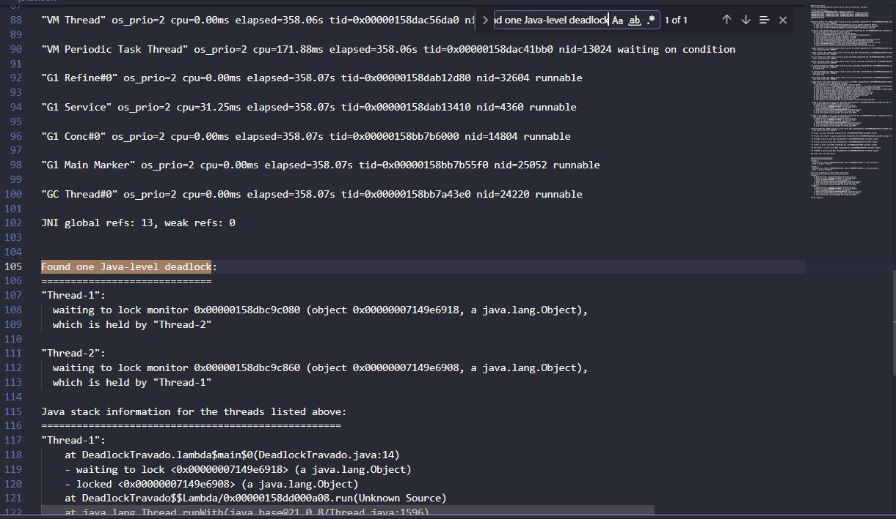
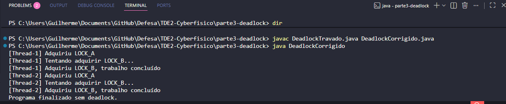

# Parte 3 — Deadlock

Reprodução de um deadlock com duas threads e dois locks (`LOCK_A` e `LOCK_B`) e correção com ordem global de aquisição de recursos.

## Arquivos

| Arquivo | Descrição |
|---|---|
| `DeadlockTravado.java` | Versão 1: Thread-1 adquire `LOCK_A` e depois `LOCK_B`; Thread-2 adquire `LOCK_B` e depois `LOCK_A`. O programa trava. |
| `DeadlockCorrigido.java` | Versão 2: as duas threads adquirem sempre `LOCK_A` antes de `LOCK_B`. O programa termina normalmente. |

## Como executar

Requer JDK 17+. Dentro da pasta `parte3-deadlock`:

```bash
javac DeadlockTravado.java DeadlockCorrigido.java
java DeadlockTravado
java DeadlockCorrigido
```

A versão travada nunca termina; use `Ctrl + C` para encerrá-la.

## Versão 1 — reproduzindo o deadlock

As duas threads usam blocos `synchronized` aninhados, em ordens opostas:

```java
// Thread-1                          // Thread-2
synchronized (LOCK_A) {              synchronized (LOCK_B) {
    dormir(50);                          dormir(50);
    synchronized (LOCK_B) { ... }        synchronized (LOCK_A) { ... }
}                                    }
```

O `Thread.sleep(50)` entre as duas aquisições garante que cada thread pegue seu primeiro lock antes de a outra tentar pegá-lo, tornando o deadlock praticamente determinístico.

### Log do console

```
[Thread-1] Adquiriu LOCK_A
[Thread-2] Adquiriu LOCK_B
[Thread-1] Tentando adquirir LOCK_B...
[Thread-2] Tentando adquirir LOCK_A...
```

As mensagens "Adquiriu LOCK_B" / "Adquiriu LOCK_A" nunca aparecem e o programa não termina: cada thread segura um lock e espera o outro para sempre.


### Diagnóstico com jstack

Com o programa travado, em outro terminal:

```bash
jps                      # lista os processos Java e seus PIDs
jstack <PID>             # imprime o estado de todas as threads da JVM
```

O próprio `jstack` detecta o deadlock:

```
Found one Java-level deadlock:
=============================
"Thread-1":
  waiting to lock monitor 0x00000158dbc9c080 (object 0x00000007149e6918, a java.lang.Object),
  which is held by "Thread-2"

"Thread-2":
  waiting to lock monitor 0x00000158dbc9c860 (object 0x00000007149e6908, a java.lang.Object),
  which is held by "Thread-1"

Java stack information for the threads listed above:
===================================================
"Thread-1":
        at DeadlockTravado.lambda$main$0(DeadlockTravado.java:14)
        - waiting to lock <0x00000007149e6918> (a java.lang.Object)
        - locked <0x00000007149e6908> (a java.lang.Object)
```

Leitura do diagnóstico:

- O objeto `...6908` é o `LOCK_A` e o `...6918` é o `LOCK_B`.
- A Thread-1 **já possui** `LOCK_A` (`locked ...6908`) e **espera** `LOCK_B` (`waiting to lock ...6918`), na linha 14 de `DeadlockTravado.java`.
- O `LOCK_B` está com a Thread-2, que por sua vez espera o `LOCK_A`, que está com a Thread-1. Isso fecha o ciclo.



## Condições de Coffman no código que trava

Um deadlock só acontece quando as quatro condições ocorrem ao mesmo tempo. Todas aparecem em `DeadlockTravado.java`:

| Condição | Onde aparece no código |
|---|---|
| **Exclusão mútua** | `LOCK_A` e `LOCK_B` são usados com `synchronized`. O monitor de um objeto só pode pertencer a uma thread por vez; as outras ficam bloqueadas. |
| **Manter e esperar** (*hold and wait*) | Os blocos `synchronized` são aninhados: a Thread-1 continua segurando `LOCK_A` enquanto tenta entrar em `synchronized (LOCK_B)`, e a Thread-2 segura `LOCK_B` enquanto tenta `LOCK_A`. |
| **Não preempção** | O monitor só é liberado quando a thread sai do bloco `synchronized`. A JVM não tira o lock de uma thread à força, e `synchronized` não tem *timeout* nem pode ser interrompido. A thread fica bloqueada indefinidamente. |
| **Espera circular** | Thread-1 espera `LOCK_B` (que está com a Thread-2) e Thread-2 espera `LOCK_A` (que está com a Thread-1): Thread-1 → Thread-2 → Thread-1. Isso acontece porque as threads adquirem os locks em **ordens opostas**. |

## Versão 2 — correção com ordem global de aquisição
A correção impõe uma hierarquia de recursos: **todas as threads adquirem sempre `LOCK_A` antes de `LOCK_B`**.

```java
// Thread-1 e Thread-2 (mesma ordem)
synchronized (LOCK_A) {
    dormir(50);
    synchronized (LOCK_B) { ... }
}
```

### Log do console

```
[Thread-1] Adquiriu LOCK_A
[Thread-1] Tentando adquirir LOCK_B...
[Thread-1] Adquiriu LOCK_B, trabalho concluído
[Thread-2] Adquiriu LOCK_A
[Thread-2] Tentando adquirir LOCK_B...
[Thread-2] Adquiriu LOCK_B, trabalho concluído
Programa finalizado sem deadlock.
```



### Qual condição de Coffman foi quebrada

A ordem global quebra a **espera circular**. Como as duas threads disputam primeiro o `LOCK_A`, só uma delas consegue entrar; a outra fica bloqueada **sem segurar nenhum lock**. Quem pegou `LOCK_A` encontra o `LOCK_B` livre, termina o trabalho e libera os dois. Só então a outra thread avança.

Para existir um ciclo, alguma thread teria que segurar `LOCK_B` e esperar `LOCK_A`, mas isso é impossível quando todas respeitam a ordem A → B. O log mostra exatamente isso: a Thread-2 só adquire `LOCK_A` depois que a Thread-1 concluiu.

As outras três condições continuam presentes (os locks seguem exclusivos, aninhados e não preemptivos). Basta quebrar **uma** das quatro para o deadlock se tornar impossível.

O custo dessa abordagem é que todo o código precisa respeitar a mesma ordem. Com muitos locks, a hierarquia precisa ser documentada e seguida por todos os desenvolvedores, senão o deadlock volta.